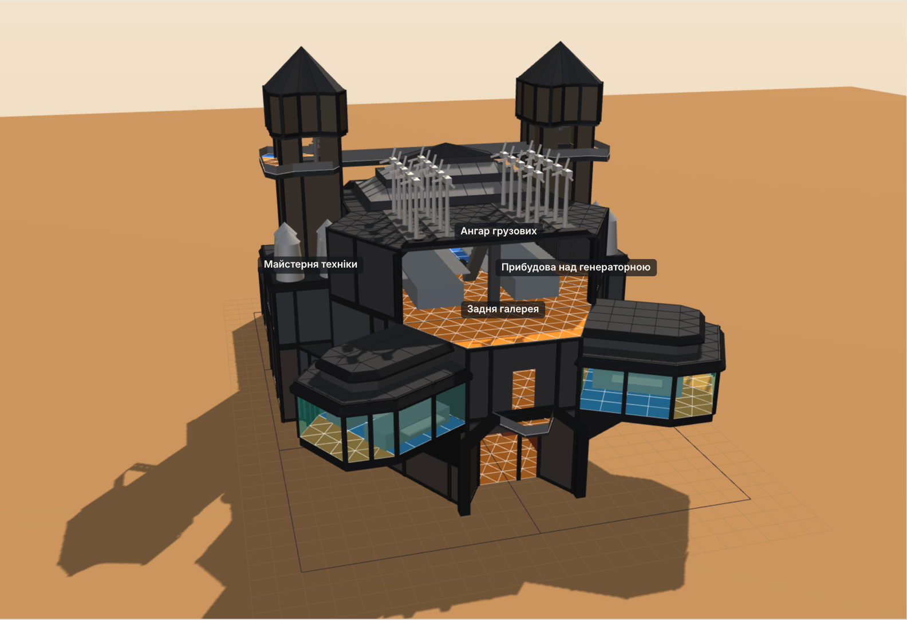
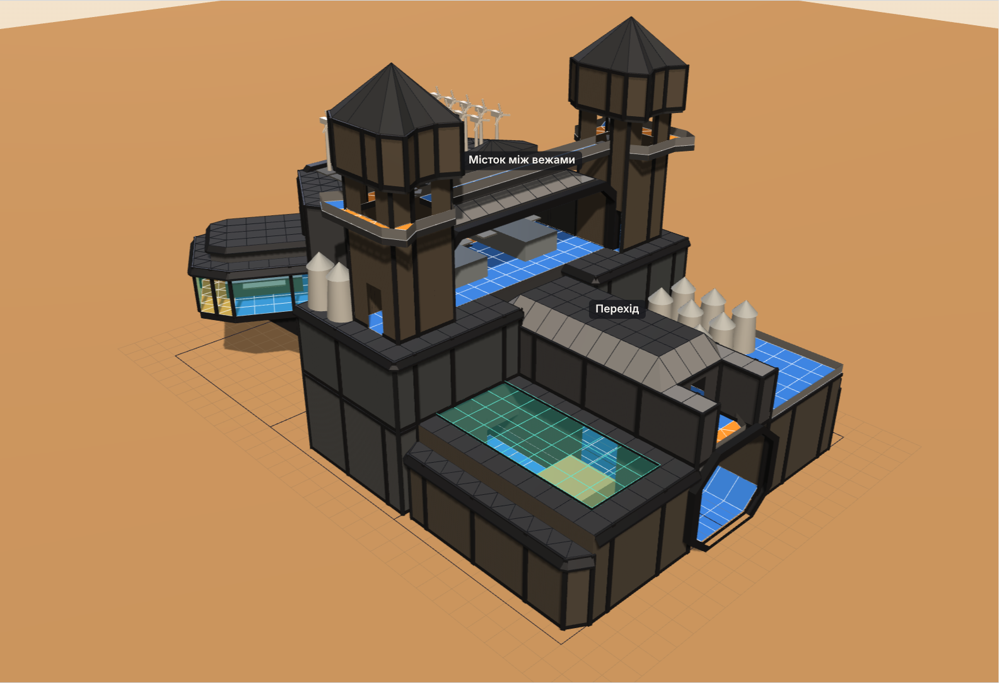
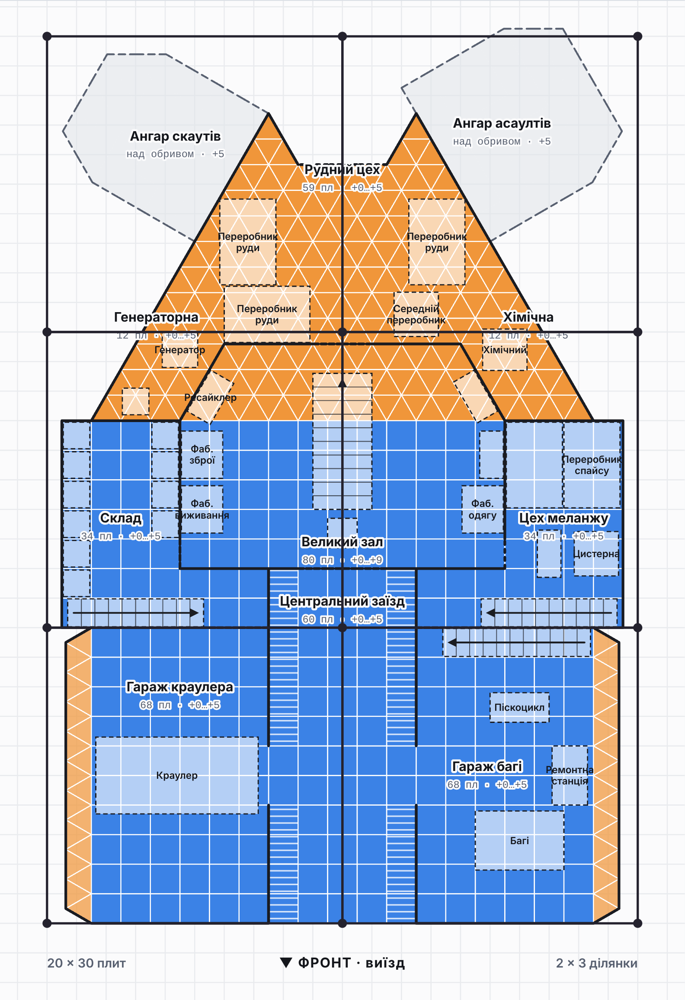
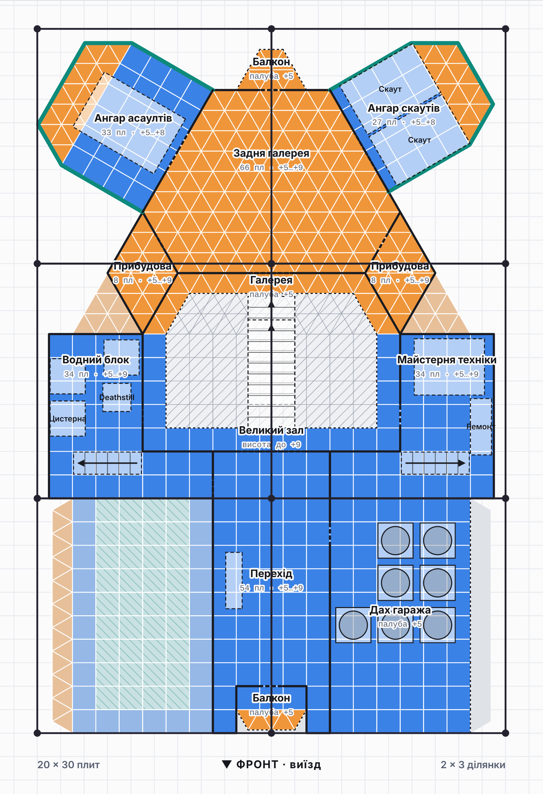

# Sandwalkers — бази, план розвитку і мапа ресурсів для Dune: Awakening

Застосунок у стилі планувальника для Satisfactory: розділи **Sandwalkers Main** (6 ділянок 10×10),
**Sandwalkers DD** (форпост у Глибокій пустелі, 1 ділянка 10×10), **План розвитку** і **Мапа ресурсів**.
Набір будівельних елементів — сардаукарський, з гранітного каменю. Використано **тільки квадратні й
трикутні плити**. Повороти на 30° зроблено так само, як у грі: квадрат → трикутник → повернутий квадрат.

## Запуск

Через Snotax console — сайт **https://dune.test** (`.snotax.yaml`: host-proxy, `npm run dev`, порт 5180):

```sh
npm install
snotax-console site link --yes      # один раз; далі консоль сама тримає dev-сервер
snotax-console worker reconcile     # якщо dev-сервер не піднявся одразу після link
```

Без консолі: `npm run dev` → http://localhost:5180 (API на :5181, Vite проксує `/api`, `/map-tiles`, `/versions`).
Прод: `npm run build && npm start` → http://localhost:5181. Потрібен Node.js 22.5+ (вбудований `node:sqlite`).

## Мапа ресурсів

Як «Карта» в Satisfactory, але для Арракіса: тайли гри і **всі точки з гри** — локації, печери, уламки,
випробувальні станції, торговці, тренери, NPC, скрині й лут, руда, рослини, підбирання, ключі
пентащитів, представники Домів. Фільтр за групами й типами, пошук місць, наведення і клік по точці
(назва, що лежить у скрині й з яким шансом, координати), позначки «зібрано».

- **Мапи:** Хагга, Глибока пустеля, Арракін, Харко, а також уламки, печери й підземелля.
- **Глибока пустеля — окрема мапа, яку буря перебудовує щотижня.** TH.GL тримає всі 12 розкладок
  (тайли й точки кожної) з позначкою поточної. Сервер сам перевіряє раз на 6 годин, яка зараз у грі,
  і веде історію тижнів; на мапі можна перемкнути тиждень. Наші точки в DD прив'язуються до свого тижня
  і на чужому показуються лише контуром — після бурі там інакше.
- **Наші ресурси** — шар поверх даних гри: де брати унікальні ресурси (те, що раніше було вкладкою
  «Ресурси»). Запис прив'язується трьома способами, і мапа показує все разом:
  - **точки** — ромби кольору спайсу (клік «Вказати на мапі» або «+ до запису» з картки точки);
  - **типи точок** — кільця навколо всіх печер, уламків, випробувальних станцій тощо;
  - **предмет луту** — усі контейнери, у луті яких він є, з відсотком випадіння і списком найкращих.
  Записи спільні (SQLite на сервері), зміни розлітаються по відкритих вкладках; «перевірено в грі» — галочкою.
- Дані мапи — [TH.GL](https://duneawakening.th.gl): сервер тягне їх з CDN і кешує на диск
  (`server/data/map`, у git не йде). `npm run map:prefetch` завантажує все наперед для роботи без мережі,
  `npm run map:sync` оновлює знімок опису мап у репозиторії (`server/map/source.json`).

## Sandwalkers Main



Ділянки стоять сіткою **2 × 3** (20 плит завширшки, 30 углиб).

- **Перед.** Центральний заїзд 3 + 2 плити, заокруглений знизу і зверху (скрін 3), заїзди в гаражі 2 плити на рівні підлоги.
  - Гараж краулера: дах зі скошеним карнизом і пентащитом 4×9 з відступом від країв.
  - Гараж багі: дах-тераса з вітропастками.
  - Над заїздом перехід зі скошеним дахом, посередині виріз із круглим балконом.
- **Центр.** Великий зал — витягнутий шестикутник: спереду квадрати 11×5, ззаду трикутна фаска. Унизу фабрикатори (виживання, зброї, одягу), ресайклер і склад деталей; галерея на +5.
  - Впритул обабіч — прямі двоповерхові блоки (спільна стіна із залом): внизу головний склад (лівий, контейнери обабіч проходу) і цех меланжу (правий, 2 великі переробники спайсу), нагорі водний блок і майстерня техніки.
  - Вежі починаються з +9 і стоять на дахах блоків; сходи в них — з другого поверху блоку через люк. Балкони з трьох боків, місток між вежами на +15 над переходом, як брама.
- **Тил.** За Великим залом задній зал — перевернутий шестикутник.
  - Перший поверх — рудний цех (3 великі переробники руди + середній) обабіч проходу до заднього входу; склад перенесено в лівий блок, бо в трикутному залі контейнери 1×1 не лягають рівно. Обабіч одноповерхові крила між тилом блоків, фаскою залу і заднім залом (зовнішня стіна навскіс): генераторна і хімічна. Над їхніми ромбами біля залу на +5 — прибудови.
  - Задній вхід заглиблено на 2 ряди: портал урівень із задньою стороною, двері глибше, над ними навіс галереї і круглий балкон.
  - До скошених граней на +5 під кутом кріпляться ангари орні (скрін): зліва асаултів — 6 плит на всю грань (один асаулт), справа скаутів — 5 плит, зсунутий на плиту до центру. Вони звисають над обривом: під ними порожньо, знизу днище і консолі. Пентащита зверху немає.
- **Ангар грузових** на 2 місця поруч стоїть на дахах Великого залу, заднього залу і прибудов: окремої підлоги немає, кожна стіна стоїть над стіною нижче (інакше в грі бракує стабільності), грані йдуть лише по ребрах плит. Спереду 11 плит і портал під містком, посередині розширення до 14 над прибудовами, ззаду портал 9 плит на задній майданчик — над ангарами орні не нависає. Вхід лише другим маршем парадних сходів по центру залу: з галереї +5 біля переходу нагору, вихід між грузовими. Трикутний дах тримає одна колона по центру біля заднього порталу. На даху ступінчаста гора (скрін 4), за нею 20 вітряків.
- **Фасади.** Кожен корпус має свій відтінок стін, ребра на кутах і стиках, пояси і карнизи.





### Рівні

| Рівень | Що там |
|---|---|
| 0 | Заїзд, гаражі, Великий зал із фабрикаторами, головний склад (лівий блок), цех меланжу (правий), рудний цех із крилами в задньому залі, заглиблений задній вхід. Під ангарами орні — обрив |
| +5 | Перехід із круглим балконом, дах гаража багі, галерея залу, водний блок, майстерня, задня галерея, прибудови над крилами, ангари орні над обривом (пентащит до +8, дах +8 і +9), задній балкон |
| +9 | Ангар грузових, задній майданчик, вежі (від даху блоків), дахи бічних блоків із вітропастками, дахи ангарів |
| +13 | Дах ангара грузових: гора до +16, 20 вітряків; балкони веж і місток +15, ліхтарі +17…+19,5 |



### Фундамент

Рівень 0 — один суцільний фундамент без жодної щілини. Квадрати і трикутники без залишку стикуються лише по горизонтальній лінії, тому квадратна частина (заїзд, гаражі, цехи, перед залу) і трикутна (фаска залу, задній зал, крила складу) межують тільки по горизонталі: по y = 17. `tools/check-model.js` перевіряє, що плитки лягають край у край і всередині немає дірок. У 3D режим «Тільки плити підлоги» показує самі плити вибраного поверху.

### План будівництва і кошторис

Унизу сторінки — етапи будівництва з кількістю деталей на кожному (фундамент → стіни 1-го поверху → перекриття +5 → 2-й поверх → ангари орні → дахи +9 і ангар грузових → вежі, гора, місток → пристрої) і кошторис: деталі в гранітному камені, пентащити й пристрої за рецептами з гри (рецепт пристрою — поле `recipe` в моделі, таблиця `RECIPES` у `src/build.js`) і підсумок «що зібрати» по всіх матеріалах. Кількість і ціну можна виправити в комірці, сума рахується. Підрахунок — `src/build.js`. На плані є опція «Координати» (стовпці A–T, ряди 1–30 від фронту).

### Як ходити базою

- **Земля.** Вулиця → заїзд → гаражі → цехи → Великий зал → головний склад і крила → задній вхід.
- **З землі на +5.** Парадні сходи Великого залу, сходи в обох цехах.
- **+5.** Перехід ↔ водний блок і майстерня ↔ галерея Великого залу ↔ задня галерея ↔ ангари орні ↔ задній балкон.
- **+9.** Ангар грузових: сходи із задньої галереї через люк на задній майданчик, або з переходу — вихід перед переднім порталом. Вежі: з водного блоку і майстерні через люк.
- **+15.** Вежі → балкони → місток. Вузькі сходи між грузовими → дах із вітряками.

### Пристрої на дахах

- **20 вітряків** (1×1): чотири стовпці по 5 за горою на даху ангара грузових (+13).
- **15 вітропасток** (1,5×1,5): 7 у глибині даху гаража багі (+5), по 4 на дахах бічних блоків (+9).
- Біля ангарів орні пристроїв немає.

## Розміри

- Грузовий 4×9, великий рудний переробник 3×2 заввишки до 2 — з уточнень.
- Великий переробник спайсу 3×2, 5 стін; цех меланжу має рівно 5 рівнів — впритул. Контейнер складу 1×1, 2 стіни заввишки.
- Скаут ≈ 3,6×2,5, асаулт ≈ 4×2,7; ангари 3 рівні скла + верхній ярус даху.
- Краулер ≈ 5,5×2,6, багі 3×2, піскоцикл 2×1.
- Вітряк займає 1×1, вітропастка 1,5×1,5. Над ними нічого немає.

**Перевірити в грі:** чи проходить краулер у заїзд шириною 2 плити, чи проходить грузовий крізь горизонтальний пентащит, чи вистачає 4 рівнів ангара грузових і чи влазить переробник спайсу під стелю на 5 стін.

## Структура

| Файл | Призначення |
|---|---|
| `index.html`, `src/main.tsx`, `src/App.tsx` | Застосунок (Vite + React + TypeScript + Tailwind + zustand) |
| `src/components/Header.tsx`, `src/store.ts` | Шапка з розділами; розділ живе в стані, адреса (`/`, `/dd`, `/plan`, `/map`) лише віддзеркалює його |
| `src/pages/BasePage.tsx`, `src/components/base/` | Сторінка бази: план, 3D, легенда, приміщення, ліміти, етапи, кошторис, версії |
| `src/pages/Roadmap.tsx` | План розвитку |
| `src/pages/MapPage.tsx`, `src/components/map/`, `src/lib/map/` | Мапа: Leaflet, шар точок на canvas (`layer.ts`), панель шарів, «Наші ресурси» |
| `src/lib/places.ts` | Записи «Наших ресурсів»: API + живі оновлення (SSE) |
| `src/lib/engine.ts` | Підключає рушій баз у застосунок |
| `src/engine/geom.js` | Спільна геометрія обох баз: плитки, предмети, межі приміщень і прорізи |
| `src/engine/model.js` | Sandwalkers Main: приміщення, плитки, прорізи, сходи, обладнання; у `ui` — тексти і кнопки сторінки |
| `src/engine/model-dd.js` | Sandwalkers DD: заокруглений корпус 10×10 — ангар важкої техніки, гараж багі, майстерня, склад, ангар асаулта; `ui.howto` — як ставити від кута ділянки |
| `src/engine/plan2d.js` | 2D-план (SVG) |
| `src/engine/build.js` | Етапи будівництва, кількість деталей, ліміти і ціни сардаукарського набору |
| `src/engine/view3d.js` | 3D-модель (three.js r128) |
| `src/engine/versions.js` | Історія версій обох баз (з комітів git) для розділу «Версії» |
| `versions/` | Знімок 3D кожної версії |
| `server/` | API: записи «Ресурсів» (`node:sqlite`, `server/data/app.db`), дані мапи з кешем TH.GL (`lib/thgl.mjs`) |
| `server/map/source.json` | Знімок опису мап TH.GL: тайли, групи й типи точок, розкладки Deep Desert |
| `data/places.json` | Записи, якими заповнюється порожня база: ресурс, місце, як дістати, точки, типи, лут |
| `scripts/map-sync.mjs`, `scripts/map-prefetch.mjs` | Оновити опис мап; завантажити дані мапи в кеш наперед |
| `classic.html`, `classic/` | Стара однофайлова сторінка на тому самому рушії — для інструментів знімків нижче |
| `tools/check-model.js` | Перевірка: межі ділянок, перекриття плиток, фундамент без щілин, техніка в приміщеннях |
| `tools/render.js` | Знімки в `renders/` (Playwright) |
| `tools/check-3d.js` | 3D без мерехтіння: жодної пари площин, що лежать одна на одній (Playwright) |
| `tools/render-versions.js` | Знімки 3D усіх версій: кожен коміт із `src/engine/versions.js` відкривається своєю сторінкою (Playwright) |
| `tools/build-artifact.js` | Збирає класичну сторінку для публікації |

```sh
npm run check            # обидві моделі: node tools/check-model.js [src/engine/model-dd.js]
npm run build            # tsc + vite build
NODE_PATH=$(npm root -g) THREE_DIR=$(pwd)/node_modules/three node tools/render.js
NODE_PATH=$(npm root -g) THREE_DIR=$(pwd)/node_modules/three node tools/check-3d.js        # або: … tools/check-3d.js dd
```
